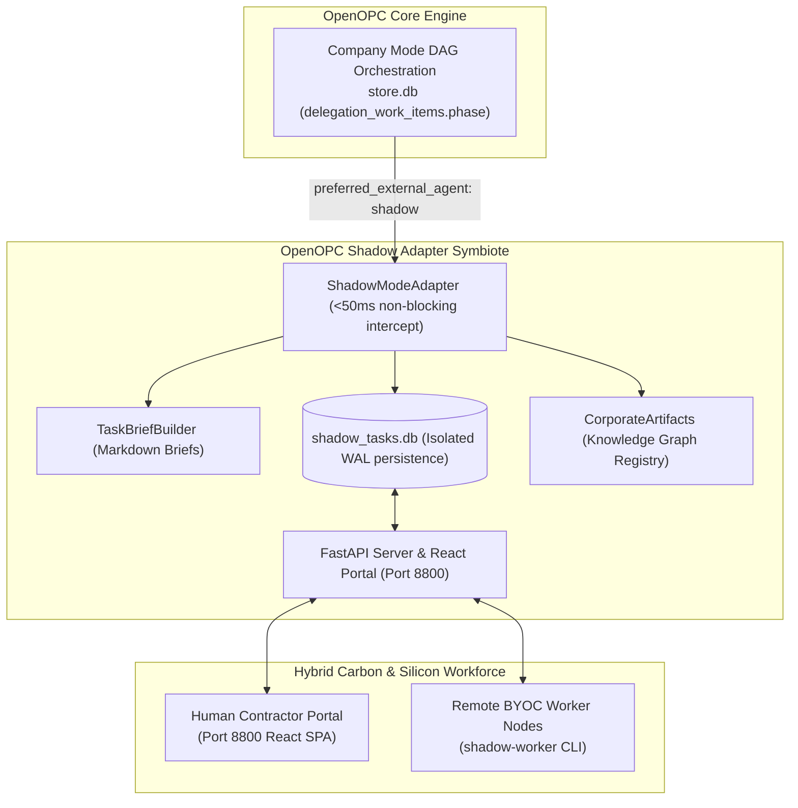

# OpenOPC Shadow Adapter: Implementation & Setup Guide

This guide provides step-by-step setup, configuration, and architectural walkthrough instructions for integrating `openopc-shadow-adapter` into your OpenOPC deployment.

---

## 1. Architecture Overview

`openopc-shadow-adapter` operates as a non-invasive **symbiotic architecture extension** for OpenOPC. It is completely independent and requires zero code modifications to the core OpenOPC repository.



---

## 2. Installation & Quick Setup Walkthrough

### Step 1: Install Package
Install `openopc-shadow-adapter` in your OpenOPC Python environment:

```bash
pip install openopc-shadow-adapter
```

### Step 2: Configure Target Roles in OpenOPC
Edit your OpenOPC organization profile (e.g. `.opc/config/company_orgs/company_config.yaml`):

```yaml
roles:
  senior_developer:
    title: "Senior Developer (Hybrid Seat)"
    execution_strategy: external
    preferred_external_agent: shadow  # <-- Intercepted by Shadow Adapter

  legal_counsel:
    title: "Human Legal Counsel"
    execution_strategy: external
    preferred_external_agent: shadow  # <-- Intercepted by Shadow Adapter
```

---

## 3. Server Deployment Options

### Option A: Embedded Launch (Single Process)
Add two lines to your main OpenOPC application script (e.g., `main.py`):

```python
from opc.layer3_agent.adapters.registry import ADAPTER_CLASSES
from shadow_adapter import ShadowModeAdapter, start_server_in_thread

# 1. Register shadow mode into OpenOPC registry
ADAPTER_CLASSES["shadow"] = ShadowModeAdapter

# 2. Start Contractor Portal REST server in background thread
start_server_in_thread(port=8800)

# 3. Launch OpenOPC DAG pipeline as normal
```

### Option B: Standalone CLI Server (`shadow-serve`)
Run the portal server as a separate process or Docker container:

```bash
shadow-serve --port 8800 --db ./shadow_tasks.db
```

* **React Contractor Portal:** `http://localhost:8800`
* **REST API Base:** `http://localhost:8800/api/v1`

---

## 4. Contractor & BYOC Workforce Setup

### Human Contractor Setup (Port 8800)
1. Open `http://localhost:8800` in browser.
2. Register/Login as a contractor.
3. Claim pending tasks assigned to your role.
4. View markdown brief, download upstream deliverables, and submit work.

### Distributed Silicon BYOC Worker Setup
Launch remote compute nodes on dedicated GPU servers or laptops:

```bash
# GPU Node running local Llama 3.3 via Ollama
shadow-worker \
  --server-url "http://<openopc-host>:8800" \
  --username "gpu_node_01" \
  --password "password123" \
  --role "senior_developer" \
  --provider "ollama" \
  --model "llama3.3:70b"

# Remote Compliance Node using Claude 3.5 Sonnet
shadow-worker \
  --server-url "http://<openopc-host>:8800" \
  --username "legal_node_02" \
  --password "password123" \
  --role "legal_counsel" \
  --provider "anthropic" \
  --model "claude-3-5-sonnet-20241022"
```

---

## 5. Security & Safety Verification

### Environment Configuration Variables

| Variable | Default Value | Description |
|---|---|---|
| `SHADOW_JWT_SECRET` | System Generated | Secret key for signing JWT tokens. |
| `SHADOW_DB_PATH` | `./shadow_tasks.db` | SQLite database path for shadow tasks. |
| `SHADOW_OPC_STORE_PATH` | `.opc/projects/default/store.db` | Path to OpenOPC `store.db` for WAL resume writes. |
| `SHADOW_UPLOAD_DIR` | `./shadow_uploads` | Storage path for deliverable file attachments. |
| `SHADOW_MAX_FILES_PER_SUBMISSION` | `5` | Max allowed files per submission. |
| `SHADOW_MAX_FILE_SIZE_MB` | `10` | Max allowed size per file in MB. |
| `SHADOW_MAX_TOTAL_UPLOAD_SIZE_MB` | `50` | Max total payload cap per submission in MB. |

### Test Suite Execution
Run the full automated test suite (64 tests) to verify system integrity:

```bash
pytest tests/ -v --cov=shadow_adapter
```


## Web research for worker deliverables

Built-in model workers can prepare current web evidence before generating a
deliverable. [Parallel Search MCP](https://docs.parallel.ai/integrations/mcp/search-mcp)
is the default research provider, with free search powered by Fast mode and page
fetching, without a Parallel account or API key. Research requires an explicit
request in the OpenOPC task's `metadata`, which the adapter preserves as
`opc_metadata`:

```python
task.metadata["web_research"] = {
    "objective": "Find the current stable Python release and its supported platforms",
    "search_queries": ["Python current stable release platforms"],
    "urls": ["https://www.python.org/downloads/"],
}
```

Supply `search_queries`, `urls`, or both. Use one focused objective (up to 200
characters), up to three nonempty queries (200 characters each), and up to 20
HTTP(S) URLs without embedded credentials. Requests to `https://search.parallel.ai/mcp`
contain these explicit research inputs, the configured model name and an opaque
research ID. Task titles, private briefs, corporate artifacts, and model
credentials are not automatically included in research requests. Omit
`web_research` for tasks that should use only their existing context.

Search excerpts and requested page extracts are appended as untrusted evidence
to the existing model prompt, with an instruction to cite source URLs. This works
with the built-in Ollama, OpenAI, Anthropic, vLLM and LiteLLM paths. It prepares
context once per task execution; the model does not autonomously call tools or
follow links. Custom handlers and the `mock` provider keep their existing behavior.

To disable external research on a worker, including requests in task metadata:

```bash
export SHADOW_SEARCH_PROVIDER=none
shadow-worker --server-url http://localhost:8800 --once
```

`--search-provider parallel|none` overrides the environment. The Python SDK has
the equivalent `ShadowWorker(search_provider="none")` option. An unconfigured
worker selects `parallel`; unknown provider values fail instead of falling back.

Research has a 30-second total timeout, configurable with `--research-timeout`
or the SDK's `research_timeout`. Context is capped at 24,000 characters. Each
execution gets a fresh opaque research ID shared by its search and fetch calls;
concurrent tasks have separate IDs. The free service has usage quotas. Invalid
requests, service errors and timeouts stop that task before model inference or
deliverable submission. The task remains claimed, following the existing worker
failure behavior; release it through the portal/API before retrying. Cancellation
propagates to the research operation.
